# E1-2. 나만의 퀴즈 게임 — Python 콘솔 프로그램 + Git 워크플로우

> Codyssey 입학연수 · 개발 입문 미션 **"컴퓨터에게 명령 내리는 말(파이썬) 처음 배우기"** 수행 보고서
> 저장소: <https://github.com/JiNS03/E1-2>

터미널에서 동작하는 퀴즈 게임을 처음부터 끝까지 구현했습니다.
- **클래스 3개**로 역할을 나눴습니다: `Quiz`, `QuizGame`, `StateStore`.
- 데이터는 **`state.json`(UTF-8)** 에 저장하므로, 프로그램을 껐다 켜도 퀴즈·최고 점수·기록이 유지됩니다.
- 개발 과정은 Git으로 기능 단위 커밋을 남겼고, 브랜치 2개(`feature/play`, `feature/bonus`)를 만들어 병합했으며, clone/pull 실습까지 기록했습니다.

---

## 목차

1. [미션 요구사항 체크리스트](#1-미션-요구사항-체크리스트)
2. [프로젝트 개요](#2-프로젝트-개요)
3. [퀴즈 주제와 선정 이유](#3-퀴즈-주제와-선정-이유)
4. [개발 환경](#4-개발-환경)
5. [실행 방법](#5-실행-방법)
6. [기능 목록 (실행 화면)](#6-기능-목록-실행-화면)
7. [파일 구조](#7-파일-구조)
8. [데이터 파일 설명 (state.json)](#8-데이터-파일-설명-statejson)
9. [코드 구조와 클래스 설계](#9-코드-구조와-클래스-설계)
10. [입력 검증·예외 처리](#10-입력-검증예외-처리)
11. [Git 워크플로우](#11-git-워크플로우)
12. [Git 저장소 복제(clone·pull) 실습](#12-git-저장소-복제clonepull-실습)
13. [테스트](#13-테스트)
14. [트러블슈팅](#14-트러블슈팅)
15. [과제 목표 정리 — 개념 설명](#15-과제-목표-정리--개념-설명)
16. [보안·기타 참고](#16-보안기타-참고)

---

## 1. 미션 요구사항 체크리스트

| 구분 | 요구사항 | 결과 | 근거 |
|---|---|:-:|---|
| 결과물 | 메뉴 번호에 따라 풀기/추가/목록/점수/종료 화면 출력 | ✅ | [6장](#6-기능-목록-실행-화면), `logs/run-01~05` |
| 결과물 | 본인 주제의 퀴즈 5개 이상 | ✅ | 기본 퀴즈 **7개** (`default_quizzes.py`) |
| 결과물 | 재실행 후에도 추가한 퀴즈·최고 점수 유지 | ✅ | [6-6](#6-6-재실행-후-데이터-유지), `logs/run-04-restart.txt` |
| 코드 구조 | 클래스 2개 이상 | ✅ | `Quiz`, `QuizGame`, `StateStore` (3개) |
| 코드 구조 | 기능별 메서드 분리 (입력/진행/저장) | ✅ | [9장](#9-코드-구조와-클래스-설계) |
| 코드 구조 | 프로젝트 루트 `state.json`, UTF-8 | ✅ | `storage.py` `STATE_PATH`, [8장](#8-데이터-파일-설명-statejson) |
| 입력 처리 | 앞뒤 공백 제거 / 문자 / 범위 밖 / 빈 입력 | ✅ | [10장](#10-입력-검증예외-처리), `menu.png` |
| 입력 처리 | Ctrl+C·EOF 시 저장 후 안전 종료 | ✅ | `ctrl_c.png`, `logs/run-06·07` |
| 입력 처리 | 파일 없음 → 기본 데이터, 손상 → 안내 후 복구 | ✅ | `corrupt_recovery.png`, `logs/run-08` |
| Git | GitHub 저장소 생성·업로드 (public) | ✅ | <https://github.com/JiNS03/E1-2> |
| Git | 의미 있는 커밋 10개 이상 | ✅ | 커밋 20개 이상, [11-2](#11-2-커밋-이력) |
| Git | 브랜치 생성·병합 (checkout, merge) 1회 이상 | ✅ | `feature/play`, `feature/bonus` → `main` (`--no-ff` 병합 2회) |
| Git | clone, pull 각 1회 이상 | ✅ | [12장](#12-git-저장소-복제clonepull-실습) |
| Git | 7종 명령어(init, add, commit, push, pull, checkout, clone) | ✅ | [11-4](#11-4-git-기초-명령어-7종-사용-기록) |
| README | 개요/주제 이유/실행 방법/기능/파일 구조/데이터 파일 | ✅ | 2·3·5·6·7·8장 |
| 제출물 | 개발 환경 스크린샷 | ✅ | `docs/screenshots/vscode.png`, `dev_env.png` |
| 제출물 | 실행 결과 스크린샷 (추가/목록/플레이/점수) | ✅ | `docs/screenshots/*.png` |
| 제출물 | `git log --oneline --graph` 스크린샷 | ✅ | `docs/screenshots/git_log_graph.png` |
| 보너스 | 랜덤 출제 | ✅ | `random.sample` |
| 보너스 | 문제 수 선택 | ✅ | "몇 문제를 풀까요?" |
| 보너스 | 힌트 + 점수 차감 | ✅ | `h` 입력, 힌트 쓴 문제는 0.5점 |
| 보너스 | 퀴즈 삭제 | ✅ | 메뉴 5 |
| 보너스 | 점수 기록 히스토리 | ✅ | `history` 필드, 메뉴 4에 최근 5회 |

---

## 2. 프로젝트 개요

| 항목 | 내용 |
|---|---|
| 프로그램 | 터미널(콘솔) 4지선다 퀴즈 게임 |
| 언어 | Python 3.10 이상 (실행 확인: Python 3.14.4), **표준 라이브러리만 사용** (`json`, `random`, `datetime`, `pathlib`, `os`, `unittest`) |
| 핵심 기능 | 퀴즈 풀기 · 퀴즈 추가 · 퀴즈 목록 · 점수 확인 · (보너스) 삭제 · 종료 |
| 데이터 영속성 | 프로젝트 루트 `state.json` (UTF-8 JSON). 추가·삭제·풀이·종료할 때마다 자동 저장 |
| 구조 | `Quiz`(문제 1개) · `QuizGame`(게임 진행) · `StateStore`(파일 입출력) + 입력 검증 모듈 |
| 버전 관리 | Git + GitHub. 기능 단위 커밋, 기능 브랜치에서 작업 후 `main`에 병합 |

전체 흐름:

```
python3 main.py
   └─ QuizGame()                     ← 생성 시 StateStore.load() 로 state.json 읽기
        └─ run()  메인 루프
             ├─ show_menu() → read_int("선택: ", 1, 6)   ← 공통 입력 검증
             └─ handle_menu() → 메뉴 표에서 메서드 찾아 실행
                  play_quiz / add_quiz / list_quizzes / show_score / delete_quiz / quit
                                    └─ 상태가 바뀌면 save_state() → StateStore.save()
        Ctrl+C / EOF → except 에서 저장 후 정상 종료 (종료 코드 0)
```

---

## 3. 퀴즈 주제와 선정 이유

**주제: 개발자 작업실 기초 — 터미널·Docker·Git·Python**

| # | 문제 (요약) | 분야 |
|:-:|---|---|
| 1 | 현재 디렉터리의 절대 경로를 출력하는 명령어 (`pwd`) | 터미널 |
| 2 | 권한 755 의 기호 표기 (`rwxr-xr-x`) | 리눅스 권한 |
| 3 | `-p 8080:80` 에서 8080 의 의미 (호스트 포트) | Docker |
| 4 | 컨테이너를 지워도 데이터가 남는 저장소 (볼륨) | Docker |
| 5 | 원격 변경을 가져와 병합하는 명령 (`git pull`) | Git |
| 6 | 키-값 쌍 자료형 (`dict`) | Python |
| 7 | 잘못된 JSON 을 읽을 때 생기는 예외 (`json.JSONDecodeError`) | Python |

**선정 이유**

1. **직전 미션(E1-1)의 복습.** E1-1에서 터미널·권한·Docker·Git을 직접 다뤘습니다. 그 개념을 문제로 만들면 한 번 더 정리할 수 있다고 봤습니다.
2. **이번 미션과 바로 이어지는 내용.** 6·7번은 이 프로그램에서 직접 쓰는 개념입니다(`dict`, `json.JSONDecodeError`). 문제를 만들면서 코드에서 왜 그 예외를 잡는지도 같이 설명하게 됩니다.
3. **정답이 하나로 분명한 주제.** 명령어·개념 문제는 4지선다로 만들었을 때 정답이 애매하지 않습니다.

각 문제에는 **힌트**(보너스)가 들어 있습니다. 예: 755 → "r=4, w=2, x=1 을 더해 자리별로 계산하세요."

---

## 4. 개발 환경

| 항목 | 버전 / 설정 |
|---|---|
| OS | Windows 11 + **WSL2 Ubuntu 26.04.1 LTS** |
| Python | **3.14.4** (`/usr/bin/python3`). 요구사항 3.10 이상 충족, 외부 패키지 없음 |
| 에디터 | VSCode 1.144.1 + Remote-WSL (WSL 안의 프로젝트를 직접 엶) |
| Git | 2.53.0, `init.defaultBranch=main`, user.name=`JiNS03` (이메일은 마스킹) |
| GitHub 인증 | GitHub CLI(`gh` 2.103.3) 자격 증명 도우미. 토큰은 저장소·문서에 남기지 않음 |

**VSCode — WSL: Ubuntu 로 프로젝트를 연 화면** (탐색기의 파일 구조, 상태 표시줄의 `WSL: Ubuntu`·`UTF-8`·`LF`·`Python` 확인)

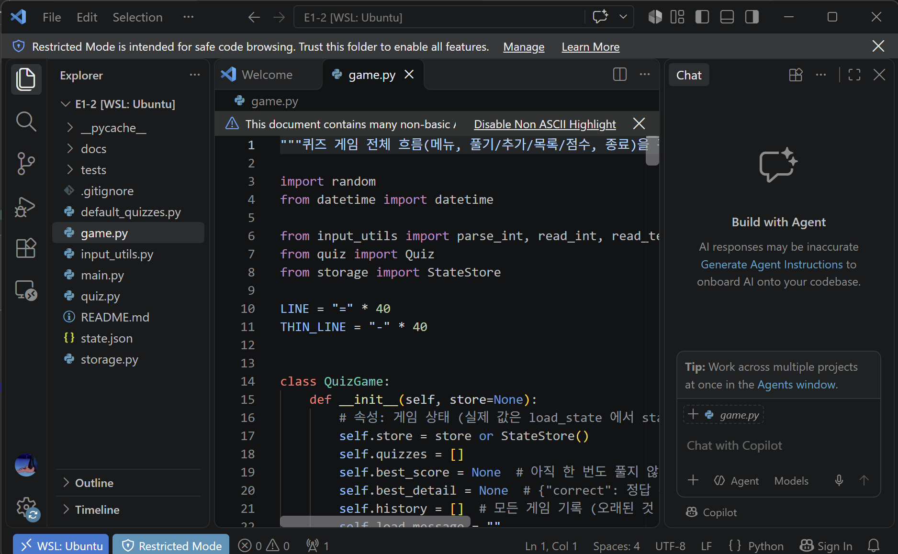

**터미널 — Python 버전, Git 설정** (`user.email` 마스킹)

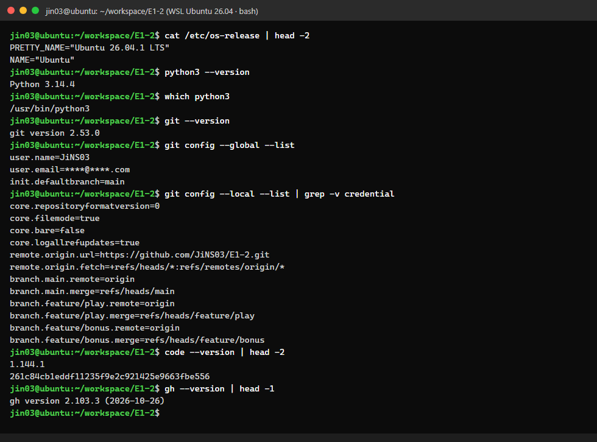

> 원본 텍스트: [`logs/dev-env.txt`](logs/dev-env.txt)

---

## 5. 실행 방법

```bash
# 1) 저장소 받기
git clone https://github.com/JiNS03/E1-2.git
cd E1-2

# 2) 실행 (설치할 패키지 없음, Python 3.10 이상)
python3 main.py          # Windows: python main.py 또는 py main.py

# 3) (선택) 단위 테스트
python3 -m unittest -v
```

- 처음 실행하면 `state.json` 이 없으므로 **기본 퀴즈 7개**로 시작합니다. 퀴즈를 추가·삭제·풀이·종료할 때 `state.json` 이 생성·갱신됩니다.
- 어느 폴더에서 실행해도(`python3 ~/workspace/E1-2/main.py`) 항상 **프로젝트 루트의 `state.json`** 을 씁니다. 경로를 `Path(__file__)` 기준으로 잡았기 때문입니다.
- 처음 상태로 돌아가려면 `state.json` 을 지우고 다시 실행하면 됩니다.

**조작법**

| 화면 | 입력 |
|---|---|
| 메뉴 | `1`~`6` (1 풀기, 2 추가, 3 목록, 4 점수, 5 삭제, 6 종료) |
| 퀴즈 풀기 | 문제 수 `1`~`N` → 각 문제마다 정답 `1`~`4`, 힌트는 `h` |
| 퀴즈 추가 | 문제 → 선택지 4개 → 정답 번호 → 힌트(선택, Enter로 생략) |
| 퀴즈 삭제 | 번호 입력(`0`은 취소) → `y`/`n` 확인 |
| 아무 때나 | `Ctrl+C` 또는 `Ctrl+D`: 저장 후 안전 종료 |

---

## 6. 기능 목록 (실행 화면)

> **스크린샷 안내**
> - `docs/screenshots/` 의 실행 화면은 WSL 터미널에서 `python3 main.py` 를 **실제 의사 터미널(PTY)로 실행**하고, 입력을 한 줄씩 넣어 기록한 화면 출력을 이미지로 옮긴 것입니다. 입력 에코까지 포함한 화면 그대로이고, 원본 텍스트는 `logs/run-*.txt` 에 있습니다.
> - 프롬프트의 호스트 이름은 `ubuntu` 로 통일했습니다.
> - `vscode.png` 는 VSCode 창을 그대로 캡처한 이미지입니다.

### 6-1. 메뉴 & 잘못된 입력 처리

메뉴는 `QuizGame.menu` 표로 출력합니다. `abc`(문자), `9`(범위 밖), Enter(빈 입력)는 각각 안내 메시지를 띄우고 다시 입력을 받습니다. `   4  ` 처럼 앞뒤에 공백이 있어도 공백을 지운 뒤 4로 처리합니다.

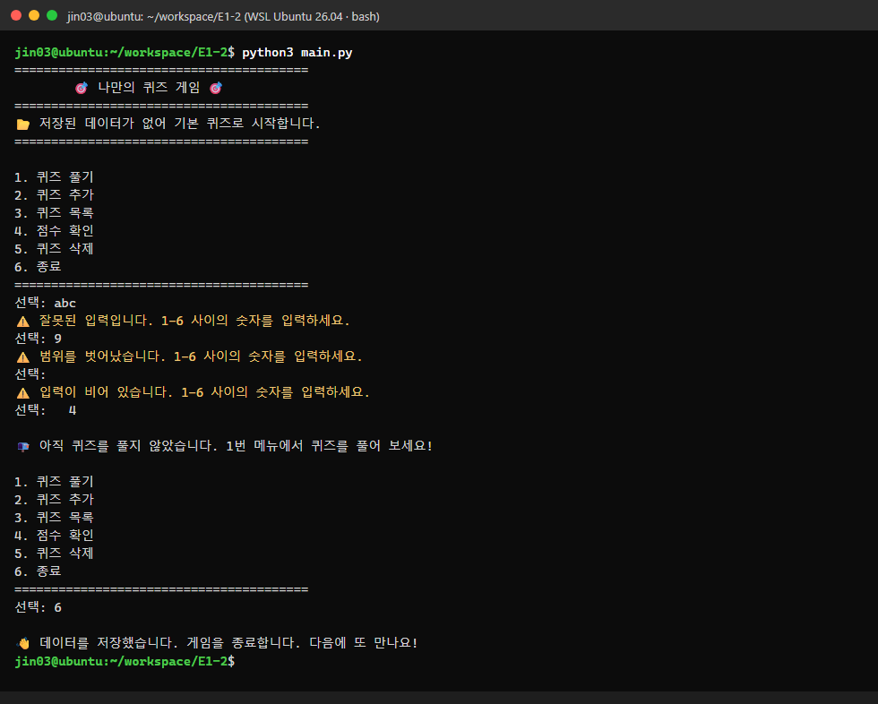

### 6-2. 퀴즈 추가 (`add_quiz`)

문제, 선택지 4개, 정답 번호, 힌트(선택)를 입력받습니다. 문제를 비우거나, 이미 입력한 선택지를 또 넣거나(`git checkout -b` 중복), 정답 번호에 문자(`abc`)를 넣으면 다시 입력을 받습니다. 추가가 끝나면 **바로 `state.json` 에 저장**합니다.

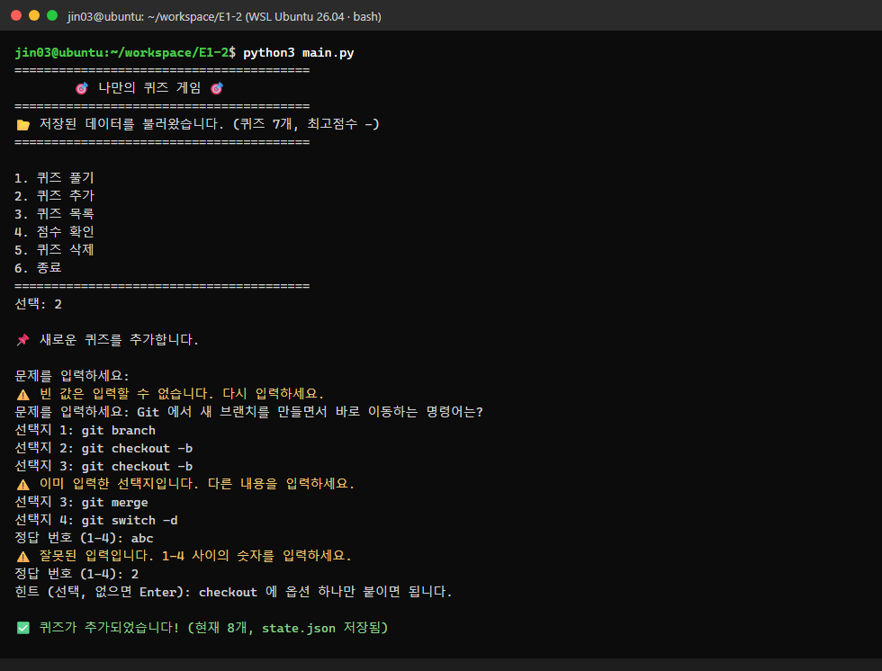

### 6-3. 퀴즈 목록 (`list_quizzes`)

등록된 퀴즈를 번호와 함께 보여줍니다. 방금 추가한 8번 문제도 목록에 나옵니다. 퀴즈가 하나도 없으면 "등록된 퀴즈가 없습니다"라고 안내합니다.

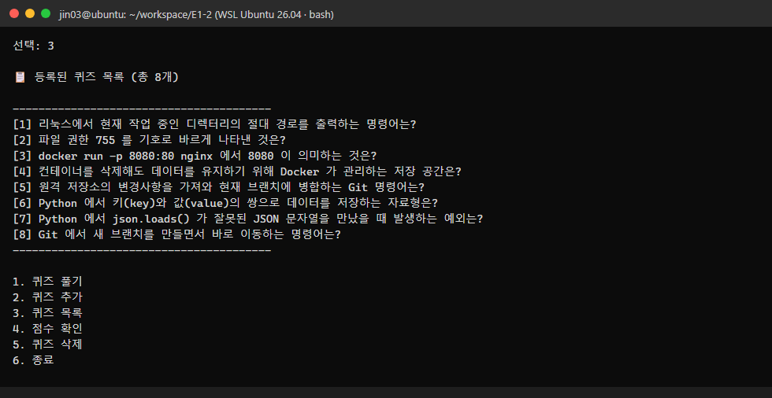

### 6-4. 퀴즈 풀기 (`play_quiz`) — 랜덤 출제 · 문제 수 선택 · 힌트

1. 풀 문제 수를 고릅니다. 범위 밖(`0`)이면 다시 입력을 받습니다.
2. `random.sample` 로 문제를 중복 없이 무작위 순서로 냅니다.
3. 문제마다 정답/오답을 바로 알려주고, 틀리면 정답도 같이 보여줍니다.
4. `h` 를 입력하면 힌트를 볼 수 있습니다. 힌트를 쓰고 맞힌 문제는 **0.5문제**로 계산합니다.
5. 모든 문제를 풀면 결과를 보여주고, 최고 점수와 비교해 더 높으면 갱신합니다.

점수 = (정답 수 − 힌트로 맞힌 문제 수 × 0.5) ÷ 출제 수 × 100 (반올림). 아래 화면은 (4 − 0.5) ÷ 5 × 100 = **70점**입니다.

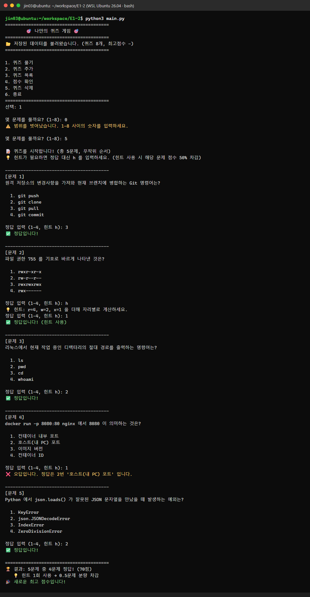

### 6-5. 점수 확인 (`show_score`) — 최고 점수 + 히스토리

최고 점수와 그때의 정답 수, 그리고 최근 5회 게임 기록을 보여줍니다(날짜/시간, 정답 수, 힌트 수, 점수). 아직 한 번도 풀지 않았으면 "아직 퀴즈를 풀지 않았습니다"라고 안내합니다(6-1 화면의 `4` 입력 결과).

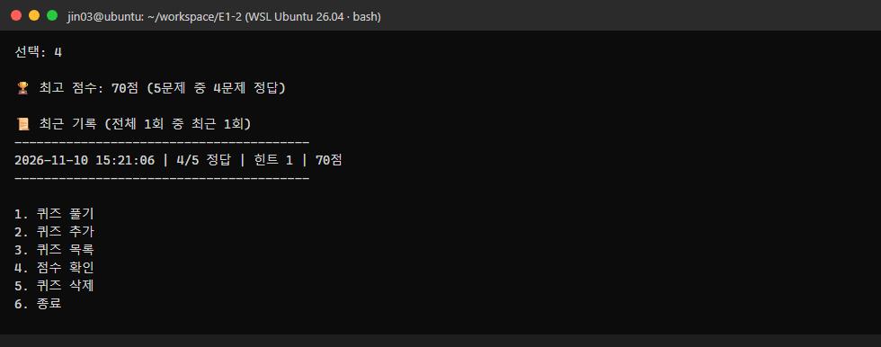

### 6-6. 재실행 후 데이터 유지

프로그램을 종료했다가 다시 실행하면 시작 화면에 `📂 저장된 데이터를 불러왔습니다. (퀴즈 8개, 최고점수 70점)` 이 나옵니다. 추가한 퀴즈, 최고 점수, 기록이 모두 그대로 남아 있습니다.

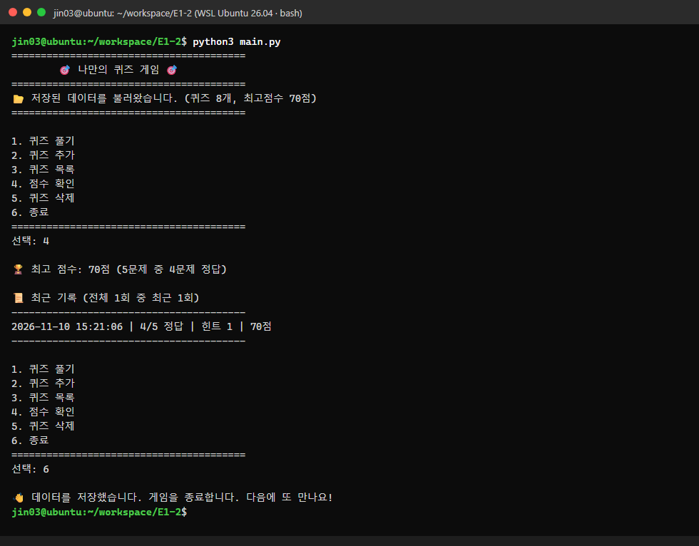

### 6-7. 퀴즈 삭제 (보너스, `delete_quiz`)

목록을 보여준 뒤 삭제할 번호를 받습니다. `0` 을 넣으면 취소됩니다. 삭제 전에 `y/n` 으로 한 번 더 확인하고, 삭제하면 `state.json` 에 바로 반영합니다.

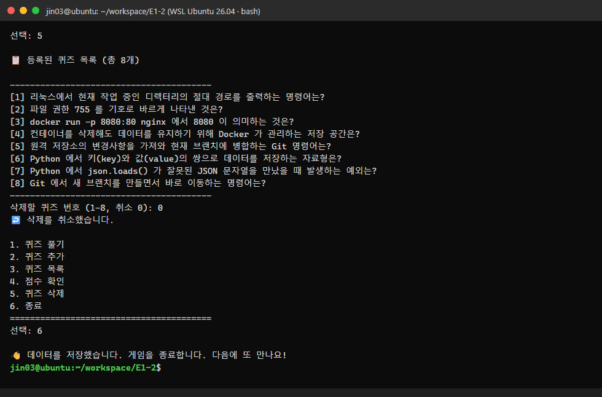

### 6-8. Ctrl+C / 입력 종료(EOF) — 저장 후 안전 종료

퀴즈를 추가하는 도중에 **Ctrl+C**(실제 SIGINT)를 누른 화면입니다. 트레이스백 없이 안내 메시지를 띄우고, 저장한 다음 종료합니다.

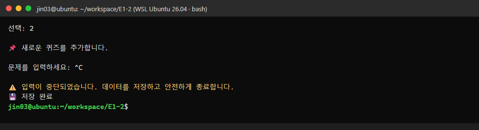

입력 스트림이 끝난 경우(EOF, 파이프 입력이 끝남)에도 똑같이 처리하고 **종료 코드 0**으로 끝납니다. 기록은 [`logs/run-07-eof.txt`](logs/run-07-eof.txt) 에 있습니다.

### 6-9. 손상된 state.json 복구

`state.json` 에 깨진 JSON 을 넣고 실행한 화면입니다. 프로그램은 원인(`JSONDecodeError`)을 알려주고, 손상된 파일을 `state.broken-<시각>.json` 으로 **백업한 뒤 기본 퀴즈로 복구**해서 계속 실행됩니다.

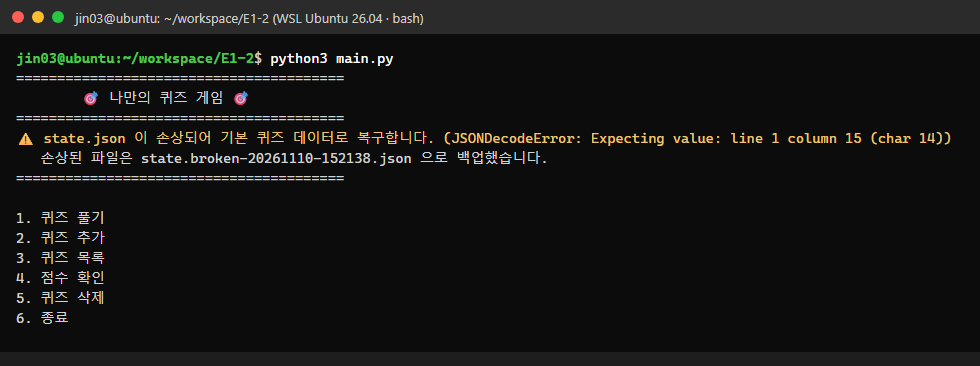

---

## 7. 파일 구조

```
E1-2/
├── main.py               # 실행 진입점: QuizGame().run()
├── game.py               # QuizGame 클래스 — 메뉴, 풀기/추가/목록/점수/삭제, 저장 호출
├── quiz.py               # Quiz 클래스 — 문제 1개(문제·선택지 4개·정답·힌트), 출력/채점/직렬화
├── storage.py            # StateStore 클래스 — state.json 읽기/검증/백업/원자적 저장
├── input_utils.py        # 공통 입력 함수 — read_int / parse_int / read_text / read_yes_no
├── default_quizzes.py    # 기본 퀴즈 7개 (Quiz 인스턴스 생성)
├── state.json            # (실행 시 생성, .gitignore) 퀴즈·최고 점수·기록
├── tests/
│   └── test_quiz_game.py # unittest 13개
├── docs/
│   ├── state.sample.json # 실제 실행 후의 state.json 사본 (스키마 예시)
│   └── screenshots/      # 개발 환경 · 실행 화면 · git log 스크린샷
├── logs/                 # 실행/테스트/Git 작업 원본 텍스트 기록
├── .gitignore
└── README.md
```

| 파일 | 줄 수 | 역할 |
|---|--:|---|
| `game.py` | 259 | 게임 진행 전체 (클래스 `QuizGame`) |
| `storage.py` | 127 | 파일 입출력 (클래스 `StateStore`) |
| `quiz.py` | 63 | 퀴즈 1개 (클래스 `Quiz`) |
| `default_quizzes.py` | 54 | 기본 데이터 |
| `input_utils.py` | 49 | 입력 검증 |
| `main.py` | 11 | 진입점 |
| `tests/test_quiz_game.py` | 143 | 단위 테스트 |

**`state.json` 을 커밋하지 않은 이유**

`state.json` 은 실행할 때마다 바뀌는 **사용자 개인 데이터**입니다. 추가한 퀴즈, 점수, 기록이 들어갑니다.
- 저장소에 포함하면 플레이할 때마다 Git 변경사항이 생기고, clone 한 사람이 남의 점수로 시작하게 됩니다.
- 그래서 `.gitignore` 에 넣었습니다. 대신 형식을 보여주는 실제 사본을 [`docs/state.sample.json`](docs/state.sample.json) 에 두었습니다.

---

## 8. 데이터 파일 설명 (state.json)

| 항목 | 내용 |
|---|---|
| **경로** | 프로젝트 루트 `E1-2/state.json`. 코드에서는 `Path(__file__).resolve().parent / "state.json"` |
| **인코딩** | UTF-8. `ensure_ascii=False` 로 한글을 그대로 저장, `indent=2` |
| **역할** | 퀴즈 목록, 최고 점수, 게임 기록을 보관해서 재실행 후에도 상태를 유지 |
| **읽는 시점** | 프로그램 시작 시 1회 (`QuizGame.__init__` → `load_state`) |
| **쓰는 시점** | 퀴즈 추가 직후, 삭제 직후, 한 판 끝난 직후, 정상 종료, Ctrl+C/EOF 종료 |

### 스키마

| 키 | 타입 | 설명 |
|---|---|---|
| `quizzes` | list | 퀴즈 목록 |
| `quizzes[].question` | str | 문제 (빈 문자열 불가) |
| `quizzes[].choices` | list[str] | 선택지 **정확히 4개** |
| `quizzes[].answer` | int | 정답 번호 **1~4** |
| `quizzes[].hint` | str \| null | 힌트 (없으면 `null`) |
| `best_score` | int \| null | 최고 점수 0~100. 아직 풀지 않았으면 `null` |
| `best_detail` | object \| null | 최고 점수일 때의 `{correct, total, hints_used}` |
| `history` | list | 모든 게임 기록 (오래된 것 → 최신 순) |
| `history[].played_at` | str | `"YYYY-MM-DD HH:MM:SS"` |
| `history[].total` / `correct` / `hints_used` / `score` | int | 출제 수 / 정답 수 / 힌트 사용 수 / 점수 |

### 예시 (실제 실행 후 파일에서 발췌, 전체는 `docs/state.sample.json`)

```json
{
  "quizzes": [
    {
      "question": "리눅스에서 현재 작업 중인 디렉터리의 절대 경로를 출력하는 명령어는?",
      "choices": ["ls", "pwd", "cd", "whoami"],
      "answer": 2,
      "hint": "print working directory 의 약자입니다."
    }
  ],
  "best_score": 70,
  "best_detail": { "correct": 4, "total": 5, "hints_used": 1 },
  "history": [
    { "played_at": "2026-11-10 15:21:06", "total": 5, "correct": 4, "hints_used": 1, "score": 70 }
  ]
}
```

### 상황별 처리

| 상황 | 동작 |
|---|---|
| 파일 없음 (첫 실행) | 기본 퀴즈 7개로 시작 (`📂 저장된 데이터가 없어 기본 퀴즈로 시작합니다.`) |
| JSON 문법 오류 (`JSONDecodeError`) | 안내 → `state.broken-<시각>.json` 으로 백업 → 기본 데이터로 복구하고 바로 다시 저장 |
| UTF-8 이 아닌 파일 (`UnicodeDecodeError`) | 위와 같음 (`ValueError` 의 하위 클래스라 함께 처리) |
| 스키마 오류 (선택지 3개, 정답 7, 키 누락 등) | `Quiz.from_dict` / `StateStore.parse` 가 `ValueError`·`KeyError`·`TypeError` 를 냄 → 손상으로 보고 복구 |
| 읽기 권한 없음 (`OSError`) | 안내 후 기본 데이터로 시작. 원본 파일은 건드리지 않음 |
| 쓰기 실패 (`OSError`) | `⚠️ state.json 저장에 실패했습니다.` 안내 후 게임은 계속 진행 |
| 저장 중 강제 종료 | `state.json.tmp` 에 다 쓴 뒤 `os.replace` 로 교체(원자적 저장)하므로 기존 파일이 반쯤 깨지지 않음 |
| 이전 형식 파일 (`hint`·`history` 키 없음) | `dict.get` 기본값으로 읽어서 그대로 호환 |

---

## 9. 코드 구조와 클래스 설계

### 클래스 관계

```
┌──────────────┐  has many   ┌──────────────┐
│   QuizGame   │────────────▶│     Quiz     │
│ (게임 진행)  │             │ (문제 1개)   │
└──────┬───────┘             └──────────────┘
       │ uses                      ▲ from_dict / to_dict
       ▼                           │
┌──────────────┐  read/write  ┌────┴─────────┐
│  StateStore  │─────────────▶│  state.json  │
│ (파일 입출력)│              └──────────────┘
└──────────────┘
input_utils (read_int / parse_int / read_text / read_yes_no) ← QuizGame 이 사용
```

**왜 3개로 나눴나.** 처음에는 `QuizGame` 이 저장까지 맡는 구조를 생각했습니다. 하지만 "화면과 진행"과 "파일 형식·오류 처리"는 바뀌는 이유가 서로 다릅니다.
- 그래서 저장 로직을 `StateStore` 로 분리했습니다.
- 이렇게 나눈 덕분에 테스트에서 `StateStore(임시 경로)` 를 넣어, 실제 `state.json` 을 건드리지 않고 게임을 검증할 수 있었습니다.

### `Quiz` (quiz.py)

| 구성 | 이름 | 설명 |
|---|---|---|
| 클래스 속성 | `CHOICE_COUNT = 4` | 선택지 개수. 숫자 4를 코드 곳곳에 직접 쓰지 않으려고 둔 상수 |
| 속성 | `question`, `choices`, `answer`, `hint` | 문제 / 선택지 4개 / 정답 번호(1~4) / 힌트 |
| `__init__` | 생성자 | 선택지 수와 정답 범위를 검증해서 **잘못된 Quiz 객체가 아예 만들어지지 않게** 함 |
| 메서드 | `display(number)` | 문제와 선택지 출력 |
| 메서드 | `is_correct(answer)` | 정답이면 True |
| 메서드 | `correct_choice()` | 정답 선택지 문자열 (오답 안내용) |
| 메서드 | `has_hint()` | 힌트가 있는지 |
| 메서드 | `to_dict()` / `from_dict()` | JSON 저장용 dict 변환 / dict를 검증해서 객체로 복원 (`@classmethod`) |

### `QuizGame` (game.py)

| 분류 | 메서드 | 역할 |
|---|---|---|
| 속성 | `store`, `quizzes`, `best_score`, `best_detail`, `history`, `menu`, `running` | 게임 상태 |
| 진행 | `run()` | 메인 루프. `KeyboardInterrupt`/`EOFError` 를 한 곳에서 처리 |
| 진행 | `print_title()`, `show_menu()`, `handle_menu(choice)` | 제목·메뉴 출력, 메뉴 표에서 메서드를 찾아 실행 |
| 풀기 | `play_quiz()` → `ask_question()` → `read_answer()` | 문제 수 선택, 랜덤 출제, 정답·힌트 입력 |
| 채점 | `calculate_score()` (`@staticmethod`), `show_result()`, `update_best_score()`, `record_history()` | 점수 계산, 결과 출력, 최고 점수 갱신, 기록 추가 |
| 관리 | `add_quiz()`, `read_choices()`, `list_quizzes()`, `delete_quiz()`, `has_quizzes()` | 추가·목록·삭제, 퀴즈가 없을 때 처리 |
| 점수 | `show_score()` | 최고 점수와 최근 기록 |
| 저장 | `load_state()`, `save_state()` | `StateStore` 에 위임 |
| 종료 | `quit()` | 저장 후 루프 종료 |

메뉴는 `if/elif` 를 나열하지 않고 `(이름, 메서드)` 리스트로 관리합니다.

```python
self.menu = [
    ("퀴즈 풀기", self.play_quiz),
    ("퀴즈 추가", self.add_quiz),
    ...
    ("종료", self.quit),
]
...
_, action = self.menu[choice - 1]
action()
```

이렇게 하면 메뉴를 추가할 때 이 표만 고치면 됩니다. 보너스로 "퀴즈 삭제"를 넣을 때 실제로 표에 한 줄만 추가했습니다. 메뉴 번호의 허용 범위(`1~len(menu)`)도 자동으로 따라 바뀝니다.

### `StateStore` (storage.py)

| 메서드 | 역할 |
|---|---|
| `default_state()` | 기본 퀴즈와 빈 점수·기록 |
| `load()` | `(state, 안내 메시지, 복구 저장 필요 여부)` 를 반환하고, 어떤 경우에도 예외를 밖으로 올리지 않음 |
| `parse(raw)` | JSON 구조와 타입을 검증하고 `Quiz` 객체로 변환 |
| `backup_broken_file()` | 손상 파일을 `state.broken-<시각>.json` 으로 옮김 |
| `save(...)` | 임시 파일에 쓴 뒤 `os.replace` (원자적 저장). 실패하면 False |

---

## 10. 입력 검증·예외 처리

모든 숫자 입력은 `input_utils.parse_int` 하나로 검사합니다. 메뉴, 문제 수, 정답, 정답 번호, 삭제 번호가 모두 여기에 해당합니다.

```python
def parse_int(raw, low, high):
    if raw == "":                       # 빈 입력
        return None, "⚠️ 입력이 비어 있습니다. ..."
    try:
        value = int(raw)                # 숫자 변환 실패 → ValueError
    except ValueError:
        return None, "⚠️ 잘못된 입력입니다. ..."
    if not low <= value <= high:        # 범위 밖
        return None, "⚠️ 범위를 벗어났습니다. ..."
    return value, None
```

| 케이스 | 입력 예 | 동작 | 증거 |
|---|---|---|---|
| 앞뒤 공백 | `"  4  "` | `strip()` 후 4로 처리 | `menu.png` |
| 숫자 변환 실패 | `abc`, `1.5` | 안내 → 재입력 | `menu.png`, `add_quiz.png`, 테스트 |
| 범위 밖 | 메뉴 `9`, 문제 수 `0`, 정답 `0` | 안내 → 재입력 | `menu.png`, `play.png` |
| 빈 입력 | Enter | 안내 → 재입력 | `menu.png`, `add_quiz.png`(문제 빈 값) |
| 선택지 중복 | 같은 선택지 두 번 | 안내 → 그 선택지만 다시 입력 | `add_quiz.png` |
| y/n 이외 | `maybe` | 안내 → 재입력 | 기능 테스트 |
| Ctrl+C | `KeyboardInterrupt` | 안내 → 저장 → 정상 종료 | `ctrl_c.png` |
| 입력 스트림 종료 | `EOFError` (Ctrl+D, 파이프 끝) | 안내 → 저장 → 종료 코드 0 | `logs/run-07-eof.txt` |
| 파일 없음/손상/권한 | — | [8장 표](#상황별-처리) 참고 | `corrupt_recovery.png` |

**`KeyboardInterrupt`/`EOFError` 를 `run()` 한 곳에서만 잡는 이유.**
- 입력 함수 안에서 잡으면 "그 다음에 무엇을 할지"(저장하고 종료)를 입력 함수가 알 수 없습니다.
- 그래서 입력 함수는 예외를 그대로 올려 보내고, 게임 전체를 아는 `QuizGame.run()` 이 저장과 종료를 맡도록 했습니다.

---

## 11. Git 워크플로우

### 11-1. 브랜치 전략

```
main ─●─●─●─●──────────●─●─●─●─●──────────────────●─●─ ...
            \         /         \                /
feature/play ●───────●           \              /
                          feature/bonus ●─●─●─●
```

| 브랜치 | 작업 내용 | 병합 |
|---|---|---|
| `main` | 초기 설정, 메뉴, Quiz, 기본 데이터, 추가/목록/점수, 리팩터링, 저장, 테스트, 문서 | — |
| `feature/play` | 퀴즈 풀기 기능 (커밋 2개) | `git merge --no-ff` → `b694ddd` |
| `feature/bonus` | 랜덤·문제 수, 힌트, 삭제, 히스토리 (커밋 4개) | `git merge --no-ff` → `6c64aae` |

- `--no-ff` 로 병합해서, 그래프에 "브랜치에서 작업하고 합쳤다"는 기록이 갈래 모양으로 남게 했습니다.
- 두 기능 브랜치는 원격에도 push 해 두었습니다(`origin/feature/play`, `origin/feature/bonus`).

### 11-2. 커밋 이력

커밋 메시지는 `Feat:` / `Refactor:` / `Test:` / `Docs:` / `Chore:` / `Merge:` 접두어를 쓰고, 무엇을 바꿨는지 괄호 안에 요약했습니다.

| # | 해시 | 브랜치 | 메시지 |
|--:|---|---|---|
| 1 | `e1e1b33` | main | Chore: 프로젝트 초기 설정 (.gitignore, README 생성) |
| 2 | `3d1e939` | main | Feat: 메뉴 화면과 공통 입력 검증(공백/문자/범위/빈 입력, Ctrl+C·EOF) 구현 |
| 3 | `2b20095` | main | Feat: Quiz 클래스 구현 (문제/선택지/정답 속성, 출력·정답 확인 메서드) |
| 4 | `6a67fe6` | main | Feat: 기본 퀴즈 데이터 7개 작성 (터미널·Docker·Git·Python 주제, Quiz 인스턴스) |
| 5 | `4894de6` | feature/play | Feat: 퀴즈 풀기 기능 구현 (순서대로 출제, 정답 입력·채점) |
| 6 | `12a991d` | feature/play | Feat: 퀴즈 풀기 결과 화면 추가 (정답 수·100점 환산 점수 표시) |
| 7 | `b694ddd` | main | Merge: feature/play 브랜치 병합 (퀴즈 풀기 기능) |
| 8 | `9e1335c` | main | Feat: 퀴즈 추가 기능 구현 (문제·선택지 4개·정답 번호 입력, 빈 값/중복/범위 검증) |
| 9 | `e12ddc3` | main | Feat: 퀴즈 목록 기능 구현 (번호별 문제 출력, 퀴즈 없음 처리) |
| 10 | `6ba6f07` | main | Feat: 점수 확인 기능 구현 (최고 점수 비교·갱신, 미응시 상태 처리) |
| 11 | `a2c5002` | main | Refactor: QuizGame 클래스 구조 정리 (메뉴 디스패치 표, 출제/채점/입력 메서드 분리) |
| 12 | `0062e76` | main | Feat: state.json 저장/불러오기 구현 (UTF-8, 원자적 저장, 손상 파일 백업 후 기본 데이터 복구) |
| 13 | `e502fdd` | feature/bonus | Feat: 랜덤 출제와 문제 수 선택 기능 추가 (random.sample) |
| 14 | `59ca4cd` | feature/bonus | Feat: 힌트 기능 추가 (Quiz.hint 속성, 풀이 중 h 입력, 힌트 사용 시 문제당 점수 50% 차감) |
| 15 | `a57e9d7` | feature/bonus | Feat: 퀴즈 삭제 기능 추가 (번호 선택·0 취소·y/n 확인 후 state.json 반영) |
| 16 | `2807914` | feature/bonus | Feat: 점수 기록 히스토리 추가 (날짜/시간·문제 수·정답 수·힌트·점수 저장, 최근 5회 표시) |
| 17 | `6c64aae` | main | Merge: feature/bonus 브랜치 병합 (랜덤·문제 수·힌트·삭제·히스토리) |
| 18 | `fb7209f` | main | Test: unittest 단위 테스트 13개 추가 (Quiz, 입력 검증, state.json 저장·복구, 점수/히스토리) |
| 19~ | | main | Docs: README 보고서, clone 실습, 스크린샷/로그 (아래 12장과 그래프 참고) |

미션의 "Git: ~ 후 커밋한다" 단계와 커밋의 대응:
- 초기 설정 → 1
- 메뉴 → 2
- Quiz 클래스 → 3
- 기본 데이터 → 4
- 퀴즈 풀기(브랜치) → 5~7
- 추가 → 8
- 목록 → 9
- 점수 → 10
- QuizGame 정리 → 11
- 파일 입출력 → 12
- README → 19 이후

### 11-3. `git log --oneline --graph` 스크린샷

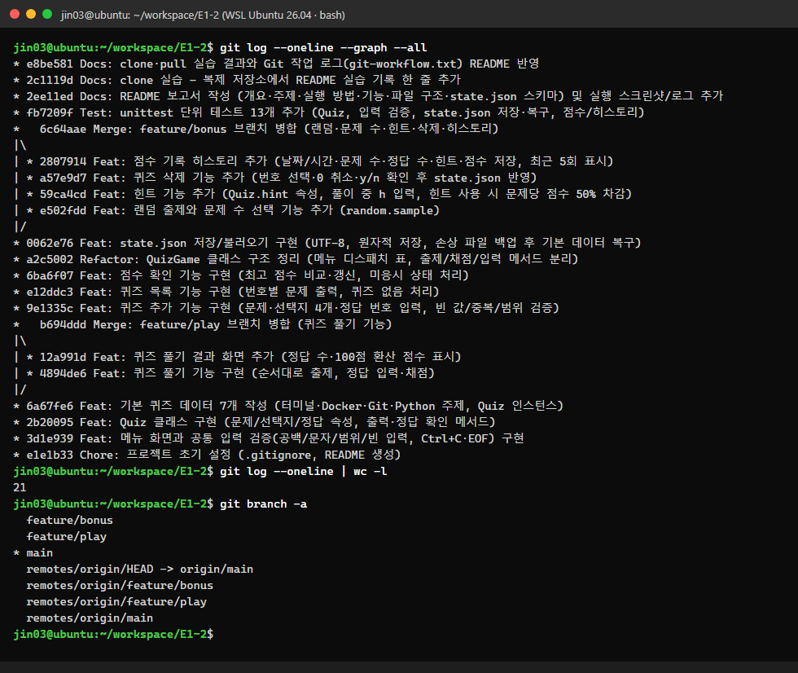

> 원본 텍스트: [`logs/git-log-graph.txt`](logs/git-log-graph.txt)

### 11-4. Git 기초 명령어 7종 사용 기록

| 명령어 | 무엇을 하나 | 이 프로젝트에서 사용한 곳 |
|---|---|---|
| `git init` | 현재 폴더를 Git 저장소로 만듦 (`.git` 생성) | 최초 설정 |
| `git add` | 변경 파일을 다음 커밋에 넣을 대상(스테이징)으로 올림 | 매 커밋 전 (`git add -A`) |
| `git commit` | 스테이징된 변경을 하나의 기록(스냅샷)으로 저장 | 20회 이상 |
| `git push` | 로컬 커밋을 원격(GitHub)에 업로드 | `push -u origin main`, 기능 브랜치 push, clone 쪽 push |
| `git pull` | 원격 변경을 가져와(fetch) 현재 브랜치에 병합(merge) | 원래 작업 폴더에서 clone 쪽 변경을 받음 (12장) |
| `git checkout` | 브랜치 이동 (`-b` 는 만들면서 이동) | `checkout -b feature/play`, `checkout main`, `checkout -b feature/bonus` |
| `git clone` | 원격 저장소 전체(이력 포함)를 새 폴더로 복제 | `~/workspace/E1-2-clone` 으로 복제 (12장) |
| (+) `git merge` | 다른 브랜치의 변경을 현재 브랜치에 합침 | `merge --no-ff feature/play`, `feature/bonus` |

모든 명령의 실제 입력·출력은 [`logs/git-workflow.txt`](logs/git-workflow.txt) 에 순서대로 남겨 두었습니다.

---

## 12. Git 저장소 복제(clone·pull) 실습

퀴즈 게임 개발과 README 작성을 마친 뒤, 미션의 절차대로 진행합니다.

| 단계 | 위치 | 명령 |
|:-:|---|---|
| ① | `~/workspace` | `git clone https://github.com/JiNS03/E1-2.git E1-2-clone` |
| ② | `~/workspace/E1-2-clone` | README 의 이 장에 한 줄 추가 → `git add` → `git commit` → `git push` |
| ③ | `~/workspace/E1-2` (기존 작업 폴더) | `git pull` |
| ④ | `~/workspace/E1-2` | `git log -1`, `grep` 으로 반영 확인 |

### 실습 기록

- (clone 실습) 이 줄은 `~/workspace/E1-2-clone` 에서 추가해 commit → push 한 변경입니다. 기존 작업 폴더에서는 `git pull` 로 받았습니다.

---

## 13. 테스트

표준 라이브러리 `unittest` 로 핵심 로직 13개를 검증했습니다. 테스트는 임시 폴더의 `StateStore` 를 쓰기 때문에 실제 `state.json` 을 건드리지 않습니다.

```
$ python3 -m unittest -v
...
Ran 13 tests in 0.002s

OK
```

| 대상 | 테스트 |
|---|---|
| `Quiz` | 정답 판정, 잘못된 선택지 수·정답 번호 거부, `to_dict`↔`from_dict` 왕복, `answer=True`(bool) 거부 |
| `parse_int` | `""`, `abc`, `9`, `0`, `1.5` 거부 / `3` 허용 |
| `StateStore` | 파일 없음 → 기본값, 저장 후 다시 읽기(한글 유지), 깨진 JSON → 백업+복구, 스키마 오류 → 복구 |
| `QuizGame` | 힌트 차감 점수 계산, 최고 점수는 오를 때만 갱신, 풀이 → 저장 → 새 인스턴스에서 유지, 퀴즈 0개 처리 |

> 전체 출력: [`logs/unittest.txt`](logs/unittest.txt)

자동 테스트 외에, 실제 실행으로 확인한 시나리오는 `logs/run-01~08` 에 있습니다. 메뉴, 추가·목록, 풀기·점수, 재실행, 삭제, Ctrl+C, EOF, 손상 파일 복구를 다룹니다.

---

## 14. 트러블슈팅

### #1 힌트 입력 `h` 를 기존 숫자 입력 함수로 받을 수 없었음
- **상황.** 보너스로 힌트를 넣으려니, 정답 입력에서 숫자 `1~4` 와 문자 `h` 를 둘 다 받아야 했습니다. 그런데 기존 `read_int()` 는 `h` 를 "잘못된 입력"으로 보고 반복 입력만 요구했습니다.
- **원인.** `read_int()` 가 **입력 받기**와 **검증**을 한 함수 안에서 같이 하고 있었습니다.
- **해결.**
  - 검증만 하는 `parse_int(raw, low, high) → (값, 오류)` 를 분리했습니다. `read_int()` 는 이 함수를 반복 호출하는 얇은 함수로 바꿨습니다.
  - 정답 입력(`QuizGame.read_answer`)에서는 먼저 `h` 인지 확인하고, 아니면 `parse_int` 로 검증합니다.
  - 그래서 공백, 빈 입력, 문자, 범위 밖 처리 기준이 메뉴와 **똑같이** 유지됩니다.
- **배운 점.** 함수 하나가 한 가지 일만 하면 재사용하기 쉬워집니다.

### #2 기능을 추가하면서 이전에 저장한 state.json 이 "손상"으로 판정될 위험
- **상황.** 힌트(`hint`)와 기록(`history`) 키를 새로 넣었습니다. 그 전 버전으로 저장된 파일에는 이 키가 없습니다.
  - `data["hint"]` 처럼 읽으면 `KeyError` 가 납니다.
  - 그러면 손상으로 판정되어 **사용자의 퀴즈와 점수가 기본값으로 초기화**됩니다.
- **해결.** 새로 생긴 키는 `data.get("hint")`, `raw.get("history", [])` 처럼 기본값을 주고 읽었습니다.
- **검증.** `hint`·`history` 가 없는 예전 형식 파일을 직접 만들어 실행했습니다. `📂 저장된 데이터를 불러왔습니다. (퀴즈 1개, 최고점수 -)` 처럼 정상으로 불러오는 것을 확인했습니다.
- **배운 점.** 저장 형식을 바꿀 때는 이미 저장된 데이터와의 **하위 호환**을 따져야 합니다.

### #3 실행 위치에 따라 state.json 이 다른 곳에 생길 수 있음
- **상황.** `open("state.json")` 처럼 상대 경로를 쓰면, 파일 위치가 **현재 작업 디렉터리(cwd)** 를 기준으로 정해집니다. 예를 들어 `/tmp` 에서 `python3 ~/workspace/E1-2/main.py` 를 실행하면 `/tmp/state.json` 이 만들어집니다. 그러면 미션 조건인 "프로젝트 루트"를 어기게 되고, 데이터가 이리저리 흩어집니다.
- **해결.** `STATE_PATH = Path(__file__).resolve().parent / "state.json"` 으로 **소스 파일 위치를 기준으로** 경로를 고정했습니다.
- **검증.** `/tmp` 에서 실행해도 `📂 저장된 데이터를 불러왔습니다. (퀴즈 8개, 최고점수 88점)` 이 나와서 루트의 파일을 읽는 것을 확인했습니다.
- **배운 점.** 상대 경로는 "어디서 실행했는지"에 따라 결과가 달라집니다.

### #4 PowerShell → WSL 로 명령을 넘길 때 따옴표가 깨짐
- **증상.** Windows PowerShell 에서 `wsl -- bash -lc "...printf \"1\n\" | python3 main.py..."` 처럼 따옴표가 겹친 명령을 넘기니 다음 오류가 났습니다.
  ```
  bash: -c: line 1: unexpected EOF while looking for matching `"'
  bash: -c: line 1: syntax error near unexpected token `('
  ```
- **원인.** PowerShell, `wsl.exe`, `bash -c` 가 각각 따옴표와 `$`·`(` 를 따로 해석합니다. 커밋 메시지의 괄호나 큰따옴표가 중간에 잘려 나갔습니다.
- **해결.** 실행할 명령을 **스크립트 파일(.sh)로 저장**하고 `wsl -d Ubuntu -- bash 파일경로` 로 실행했습니다. 커밋 메시지는 스크립트 안에서 `"$1"` 인자로 넘겼습니다.
- **배운 점.** 셸을 여러 겹 거치는 명령은 직접 문자열로 넘기지 말고 파일로 넘기는 편이 안전합니다.

### #5 `wsl` 실행 시 `execvpe(bash) failed: No such file or directory`
- **증상.** 평소처럼 `wsl --cd ~ -e bash -lc '...'` 를 실행하니 bash 를 찾을 수 없다는 오류가 났습니다.
- **원인.** `wsl -l -v` 로 확인해 보니 **기본 배포판이 `docker-desktop`** 으로 바뀌어 있었습니다(`* docker-desktop Running`). Docker Desktop 의 최소 배포판에는 bash 가 없습니다.
- **해결.** 모든 명령에 `wsl -d Ubuntu` 로 배포판을 명시했습니다. 기본값을 바꾸려면 `wsl --set-default Ubuntu` 를 쓰면 됩니다.
- **배운 점.** 오류 메시지가 "파일 없음"이어도 실제 원인은 "다른 환경에서 실행 중"일 수 있습니다. 환경부터 확인합니다.

---

## 15. 과제 목표 정리 — 개념 설명

### Python 기초

| 개념 | 설명 | 이 프로젝트에서의 예 |
|---|---|---|
| **변수** | 값에 이름을 붙여 저장하는 상자. 같은 값을 여러 번 쓰거나, 바뀌는 상태를 추적하거나, 의미를 드러내려고 씀 | `correct = 0` 으로 시작해서 맞힐 때마다 `correct += 1` |
| **int** | 정수 | `answer = 2`, `best_score = 70` |
| **str** | 문자열(텍스트) | `question = "파일 권한 755 를..."` |
| **bool** | 참/거짓 | `self.running = True`, `is_correct()` 의 반환값 |
| **list** | 순서가 있고 바꿀 수 있는 모음, 인덱스로 접근 | `choices = ["ls", "pwd", "cd", "whoami"]`, `self.quizzes` |
| **dict** | 키→값 쌍, 이름으로 접근 | `{"question": ..., "choices": ..., "answer": 2}`, JSON 객체와 1:1 대응 |
| **if/elif/else** | 조건에 따라 다른 동작 | `parse_int`: 빈 입력 / 숫자 아님 / 범위 밖 / 정상 |
| **for** | **정해진 모음을 처음부터 끝까지** 반복할 때 | `for number, quiz in enumerate(selected, start=1)` 로 문제 출제 |
| **while** | **조건이 만족될 때까지 횟수를 모르고** 반복할 때 | 메인 루프 `while self.running`, 올바른 값이 들어올 때까지 `while True` 재입력 |
| **함수** | 이름 붙은 코드 묶음. **매개변수**로 입력을 받고 **반환값**으로 결과를 돌려줌 | `parse_int(raw, low, high)` → `(값, 오류)`, `calculate_score(correct, total, hints_used)` → 점수 |

### 클래스와 객체

- **클래스**는 데이터(속성)와 그 데이터를 다루는 기능(메서드)을 한 덩어리로 묶은 **설계도**입니다. **객체**(인스턴스)는 그 설계도로 만든 실물입니다.
  - `Quiz` 클래스 하나로 7개 이상의 퀴즈 객체를 만듭니다.
  - 각 객체는 자기 문제와 정답을 갖고, 같은 `is_correct()` 메서드를 씁니다.
- **왜 쓰는가.** 관련된 데이터와 동작이 흩어지지 않게 하려고 씁니다. 문제·선택지·정답을 각각 별도 리스트로 관리하면 서로 어긋나기 쉽습니다. `Quiz` 로 묶으면 한 문제의 정보가 항상 함께 다닙니다. 역할별로 클래스를 나누면 고칠 곳도 분명해집니다(저장 문제 → `StateStore`).
- **`__init__`**: 객체를 만들 때 자동으로 호출되는 초기화 메서드입니다. `Quiz(...)` 를 호출하면 `__init__` 이 실행되어 속성을 채우고, 잘못된 값이면 `ValueError` 를 냅니다.
- **`self`**: "지금 이 메서드를 호출한 그 객체 자신"입니다. `self.answer` 는 **이 퀴즈의** 정답이고, `self.save_state()` 는 **이 게임의** 저장 메서드입니다. 파이썬은 `quiz.is_correct(2)` 를 `Quiz.is_correct(quiz, 2)` 로 바꿔서 호출합니다.
- **속성 / 메서드**: 속성은 객체가 가진 데이터(`quiz.question`), 메서드는 객체가 할 수 있는 동작(`quiz.display(1)`)입니다.
  - 이 프로젝트에서는 클래스 속성(`Quiz.CHOICE_COUNT`, 모든 객체가 공유)과 인스턴스 속성(`self.question`, 객체마다 다름)을 구분해서 썼습니다.
  - 객체가 필요 없는 메서드에는 `@staticmethod`(`calculate_score`)와 `@classmethod`(`from_dict`)를 썼습니다.

### 파일 입출력

- **기본 과정: 열기 → 읽기/쓰기 → 닫기.**
  - `with open(path, "w", encoding="utf-8") as file:` 처럼 `with` 를 쓰면, 블록이 끝날 때(오류가 나도) 파일이 자동으로 닫힙니다.
  - 모드는 `"r"`(읽기, 기본), `"w"`(덮어쓰기), `"a"`(이어쓰기)입니다.
  - 한글이 깨지지 않도록 `encoding="utf-8"` 을 명시했습니다.
- **JSON** (JavaScript Object Notation)은 `{키: 값}`, `[목록]`, 문자열, 숫자, true/false, null 로 데이터를 표현하는 **텍스트 형식**입니다.
  - Python 의 dict/list 와 구조가 거의 같아서 `json.dump`/`json.load` 로 바로 바꿀 수 있습니다.
  - 사람이 읽고 고칠 수 있고, 언어에 상관없이 쓰입니다. 그래서 설정이나 상태 저장에 많이 씁니다.
  - 단, 객체(`Quiz`)는 바로 저장할 수 없습니다. 그래서 `to_dict()`/`from_dict()` 로 변환합니다.
- **try/except**: 오류가 날 수 있는 코드를 `try` 에 넣고, 특정 예외가 나면 `except` 에서 처리합니다. 그러면 프로그램이 멈추지 않습니다.
  - `int("abc")` → `ValueError` → 재입력
  - 깨진 JSON → `JSONDecodeError` → 백업 후 복구
  - 파일 권한 → `OSError` → 안내
  - `Ctrl+C` → `KeyboardInterrupt` → 저장 후 종료

### Git 기초

- **Git** 은 파일의 변경 이력을 기록하는 **분산 버전 관리 시스템**입니다.
  - 언제, 누가, 무엇을, 왜 바꿨는지 남기고, 언제든 과거 상태로 돌아갈 수 있습니다.
  - 브랜치로 작업을 나눠 진행하고 합칠 수 있어서 협업에 꼭 필요합니다.
  - **GitHub** 은 Git 저장소를 온라인에 올려 공유하는 서비스입니다.
- 명령어 7종은 [11-4](#11-4-git-기초-명령어-7종-사용-기록)에 정리했습니다. 이 프로젝트에서 실제로 해 본 것:
  - 브랜치 생성·병합: `checkout -b` → 커밋 → `checkout main` → `merge --no-ff`
  - clone·pull: [12장](#12-git-저장소-복제clonepull-실습)

---

## 16. 보안·기타 참고

- **민감정보.**
  - Git 설정 화면과 로그의 `user.email` 은 `****@****.com` 으로 마스킹했습니다.
  - GitHub 인증은 GitHub CLI 자격 증명 도우미를 써서, **토큰이 저장소·로그·스크린샷 어디에도 남지 않게** 했습니다.
  - `git config --local --list` 를 보일 때도 `credential` 줄은 제외했습니다.
  - 커밋 전에 토큰 패턴(`gh*_`), 이메일, `password=` 를 검색해서 없는지 확인했습니다.
- **`.gitignore`** 대상: `__pycache__/`, `state.json`, `state.json.tmp`, `state.broken-*.json`, 에디터 설정 폴더.
- **외부 라이브러리 없음.** `import` 는 모두 표준 라이브러리입니다(`json`, `os`, `random`, `datetime`, `pathlib`, `unittest` 등).
